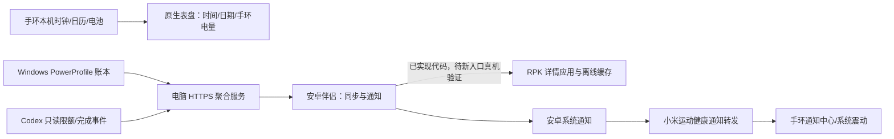

# PowerProfile 表盘与应用路线

更新：2026-11-18。关联 [Issue #23](https://github.com/LumishadeVoyager/xiaomi-band-agent-companion/issues/23)、[PR #24](https://github.com/LumishadeVoyager/xiaomi-band-agent-companion/pull/24)。本次用户要求优先于之前“只有监看应用”的产品形态。

## 产品决策

采用“原生表盘 + 详情应用 + 系统通知”三部分。表盘必须保留时间、日期和**手环自身电量**；其他 PowerProfile 指标不要求在表盘出现。首个表盘优先把这三项做好，不把所有统计挤在主屏。详情应用继续呈现今日电脑使用、估算用电、游戏、AI Token 与 Codex 额度。完成提醒进入系统通知中心，不依赖某个应用页面保持前台。

**现有 RPK 是应用，不是表盘。当前没有已构建或已验收的 PowerProfile 原生表盘 BIN/FACE。** 本次 HTML 是可交互设计预览；其中第三项按现有 UX 页面样式复现，不是真机截图、Vela 模拟器截图或运行在手环上的证明。预览全部使用虚构示例数据，手环电量 62% 也仅为样例。

## 设计规格

用户已在交互预览中选择“静谧”方案，后续原生表盘以此布局推进；选择设计不等于原生表盘已实现或安装。

画布按现有设备工程的竖屏 336×480，边缘保留安全区。小米官方规格写为 480×336，见[官方规格](https://www.mi.com/global/product/xiaomi-smart-band-10-pro/specs/)，方向仍须真机确认。

- **静谧（推荐）**：黑底、奶白小时、浅青柠分钟，分成两行的大数字；上方日期与星期，下方手环电量；右侧细条仅表示同一手环电量。没有随机曲线、无来源健康分数或电脑电量。
- **刻度**：上部小指针盘，下部数字时间、日期与电量。刻度与读数分区，避免重叠。只有时/分针，不使用秒针或持续动画。
- 强调色可调，布局不随颜色改变；默认不添加公司标识、系统原图或复制商业表盘。浏览器使用系统无衬线字体。设备端字体需另行确认可用字体与授权，不能把桌面字体效果当作设备端已实现。
- 基础信息在手机/电脑离线后仍应更新；不能把时间、日期或百分比画死在背景图中。相片表盘只可能作为自定义背景方案，不能冒充完整自定义的实时三项布局。

## 数据与职责

此图刻意不画手机或 RPK 到原生表盘的任意数据注入通道，因为尚未验证存在。`system.interconnect` 的应用消息通道不等于 Lua 表盘具备相同接口，两个沙箱不能假设共享文件。用户现在允许详情留在应用，因此首版不必承担该阻塞。

## 原生表盘技术验证

候选路线为标准表盘容器中的 Lua/LVGL。社区原作者的[运行示例](https://github.com/m0tral/MiWatchLuaWatchfaces/blob/master/RedmiWatch4/Diffusion/app/main.lua)展示 `dataman` 的小时、分钟和 `systemStatusBattery`；[另一个示例](https://github.com/m0tral/MiWatchLuaWatchfaces/blob/master/MiBand9/watchface_366269993/app/_lua/smash/smash.lua)展示日期/星期。其设备不是本项目的 10 Pro，接口名和 Q24.8 数值换算只作为候选，不能据此标支持。本机历史研究有 Lua 容器探针，也不等于时间/电池订阅已验收。

不引入修改固件、写内存、内核扩展或替换信任根的依赖。标准表盘接口不足就如实记录，不为了显示统计扩大到系统改造。

| 门槛 | 通过条件 | 当前状态 |
| --- | --- | --- |
| G0 目标与容器 | 精确型号/地区/固件、可用构建器及许可、安装身份、回切原表盘方式；独立测试包 | PowerProfile 表盘未实现 |
| G1 时钟 | 本机数据源；分钟进位、23:59→00:00、12/24 小时设置；无电脑连接也更新 | 待真机 |
| G2 日期 | 月末、闰日、星期与本机时区；手机同步时间后正确更新 | 待真机 |
| G3 手环电池 | 本机电池源；0/1/99/100%、充电插拔；读不到显示未知，不用电脑/手机值代替 | 待真机 |
| G4 系统交互 | 长按更换表盘、原生手势、亮灭屏和重进；无阻塞循环或残留订阅 | 待真机 |
| G5 息屏与功耗 | 首版不承诺 AOD；实现前核对原生生命周期、低刷新、位移/亮度限制与实机耗电 | 未实现 |
| G6 可选扩展 | 只在查明合法的数据/点击入口后，加入最多两项指标或跳转详情；断连/跨日/超时明确标旧 | 不阻塞基础表盘 |

本轮交付设计和决策文件，不伪造一个看似可安装的空 BIN。发布前必须回读真实包身份/内容、SHA-256、适用固件和安装结果；格式测试或 CI 通过不代替设备验收。

## 保留并完善的应用链路

现有 RPK/APK、只读聚合服务及 20 项自动测试已完成。2026-11-18 应用 versionCode 8 已有真实快照回执、用户确认的完整展示与短时息屏同步证据；手机 versionCode 9 的诊断通知送达与手环震动也已由用户确认。真实 Codex 完成整条链路、长时后台和重连仍分别验收，详见[真机记录](./POWERPROFILE_DEVICE_ACCEPTANCE.md)。这些应用结果不改变原生表盘 G0–G6 状态。

1. **数据正确性**：使用 PowerProfile 已有合并口径；缺失/损坏显示未知；AI Token 与订阅额度分开；日期及每字段更新时间保留。服务关闭期间新建的 Codex 会话可能被下次启动的历史基线跳过，不能承诺离线期间每条完成事件必达。
2. **运行可靠性**：先验证同一局域网、手机锁屏和重连，再决定开机服务注册、退避与后台耗电策略。当前电脑服务是手动启动，手机固定 15 秒轮询；尚未做按前台/后台自适应或续航测量。电脑启动入口和手机连接状态应成为可见设置。
3. **通知可靠性**：`task_complete` 是当前本机观察到的日志事件，版本变化需要适配检测；去重 ID 与手机通知 ACK 不等于真机送达。须测权限拒绝/恢复、渠道关闭/恢复、勿扰、摘腕与断连；不自动发送真实测试消息。日常通知仍经小米运动健康，不让 AstroBox 中转。
4. **身份与更新**：保留当前 TLS 钉扎、签名配对与信任根；表盘、RPK、APK 为不同产物，更新能力分别验证。原生表盘暂不放入 RPK OTA 流程，不用定时重装表盘来刷新统计。
5. **手机最小操作**：首配一次、之后仅设置与故障时查看；还需要把当前开发用配对 Intent 完善为可用的配对入口。当前“有构建包”尚不等于首次设置已经产品化。

## 可核对交付

运行 `node scripts/export-powerprofile-delivery.cjs` 会先审计当前 APK 的嵌入身份/版本/凭据边界，再把已存在的 APK/RPK 和说明、真实 SHA-256 清单导出到 `.local/deliveries/powerprofile/`。不生成新签名、不上传、不写 OTA，也不将两个应用包改名成表盘。文件类型、未完成事项及本地验证均写入导出清单。该目录含开发包，不提交公开仓库。
