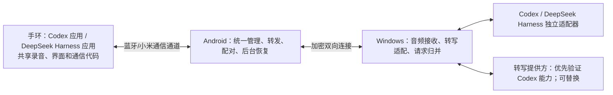

# 小米手环 Agent 伴侣：需求规格说明书

版本：v0.4

日期：2026-11-17

状态：根据用户当前明确需求整理的开发基线；尚未进行真机可行性验证。文中的默认交互、性能数值和技术选择是建议基线，不代表已完成或已被用户逐项验收。

## 1. 产品目标

用户在小米手环 10 Pro 上查看已有 Codex 或 DeepSeek Harness 聊天，使用**手环自身麦克风**录制提示词，经手机连接电脑，让所选 Agent 在正确的聊天中执行下一步，并在手环上查看状态、回复和提醒。

v0.2 新增两个并行技术方向：**P0 支持 DeepSeek Harness，与 Codex 同为核心执行后端；P2 支持近两年的其他同类小米手环，包含 9 Pro、10、11 等候选系列**。项目从单后端个人工具升级为公开 GitHub 项目，开发任务、代码审阅、验证和发布均在 GitHub 留痕，三端自动 OTA 更新流程列为 P0 发布能力。

v0.3 明确入口：**Codex 与 DeepSeek Harness 在手环应用列表中显示为两个独立应用**，分别进入各自流程；录音、转写、通信、状态协议和更新共享底层实现。P1 为直接接入个人电脑的 Claude Code，以及多个预设角色的飞书智能体。

v0.4 更新飞书边界：**只通过用户安卓手机上已登录的飞书 App 向指定智能体会话发送消息**，不直接接入公司电脑、公司侧 Lark Bridge 服务或企业后端。公司已有桥接保持现状，本项目无需知道其内部执行主机和角色提示词。

下文沿用的 Codex 专用接口描述是 Codex 适配器的技术参考。通用的录音、转写、草稿、会话、执行、取消、回执和验收要求同时适用于两个后端；不得把 DeepSeek Harness 支持解释为只把 Codex 的模型供应商换成 DeepSeek API。

语音采集必须来自手环。语音转文字可以发生在手环、手机或电脑，按真实可用性、效果、开发成本和稳定性选择。用户明确接受两类路径：手环先转文字再发送，或手环发送音频到手机/电脑后转写。优先评估第二类。

本项目整合两项上游的有用能力：Codex Quota Band 的三端看板、连接、配对、额度和任务状态，以及 Xiaomi Band Codex Notify 的简单通知入口和回复摘要体验。产品最终提供共享 Windows 服务、统一手机管理入口、手环上的独立 Codex 与 DeepSeek Harness 应用及统一配对体验。Android 是否需两个轻量桥接安装包，由小米 SDK 多包身份验证决定；不能为维持单 APK 而把两个手环应用改回一个应用里的切换器。

### 1.1 不可降低的交付条件

1. 必须使用手环自身麦克风；手机麦克风、电脑麦克风和手动文字输入不算完成此需求。
2. 正常使用时，从手环开始录音、查看转写、发送提示词、查看反馈，不要求拿出手机操作。
3. 必须能进入已有目标聊天，读取历史并继续交流，不能只建立一个不关联原上下文的新聊天。
4. 必须闭环验证：手环录音 → 传输 → 转写 → 指定会话 → Codex 执行 → 手环显示结果。
5. 仅能收通知、看额度、发预设文字的版本是阶段验证版，不能称为首个满足核心需求的可用版本。
6. 如果目标手环固件无法提供可用音频出口，记录核心阻塞与实测证据，不能静默把语音改成可选项或宣布项目完成。
7. Codex 与 DeepSeek Harness 必须各自完成原会话的手环语音闭环；只完成一个后端，不算 P0 全部完成。
8. 首个可安装核心版本须具备实际可用的更新发现、校验、安装衔接与结果反馈；仅放一个 Release 下载链接不算 OTA。
9. 手环应用列表里能同时看到并分别打开 Codex、DeepSeek Harness，包名互不覆盖，入口绑定对应后端。不能以一个手环应用内的后端切换代替两个独立应用。

## 2. 目标设备与使用前提

| 角色 | 当前信息 | 约束 |
| --- | --- | --- |
| 手环 | 小米手环 10 Pro；产品型号 M2551B1 | 地区/固件及第三方录音能力待实测；必须按实际屏幕适配 |
| 手机 | realme GT Neo 6 SE；realme UI 7.0 | 日常作为桥接，需验证锁屏后台及蓝牙重连 |
| 电脑 | Windows；预期长期开机；本次检查 Codex CLI 0.153.4 | 电脑服务和 Codex 必须可用；开机不等于服务可达 |
| 网络 | 首版建议同一可信局域网，手环经蓝牙连接手机 | 外网/蜂窝网络访问列为后续范围，不默认已解决 |

首次安装、配对、授权和维护可使用手机与电脑；完成设置后的核心日常流程应在手环完成。小米运动健康保持手环日常主连接，侧载工具仅用于安装/升级，不要求用户每次切换连接应用。

## 3. 范围与优先级

P0 是语音首版的必要条件；P1 是完整个人版的计划功能，不能因完成 P0 就声称全部需求完成；P2 是后续扩展。

| 编号 | 优先级 | 需求 |
| --- | --- | --- |
| REC-01 | P0 | 在手环发起和结束手环麦克风录音 |
| AUD-01 | P0 | 音频经手机送到实际转写端，传输可验证且可重试 |
| STT-01 | P0 | 中文提示词转文字，支持夹杂英文技术词与项目名 |
| DRAFT-01 | P0 | 手环显示转写草稿，确认、重录或取消 |
| CHAT-01 | P0 | 列出、选择已有 Codex 聊天，查看分页历史 |
| CMD-01 | P0 | 把转写文本发送到所选会话，支持空闲启动和运行中补充 |
| TASK-01 | P0 | 显示当前状态、最后回复；结束或需要处理时提醒 |
| LINK-01 | P0 | 一次配对、连接状态、断线恢复、命令去重及明确错误 |
| SETUP-01 | P0 | Windows、Android、手环三端身份、签名、版本及安装配套 |
| AGENT-01 | P0 | Codex 与 DeepSeek Harness 独立适配、原会话读写、状态和执行回执 |
| ENTRY-01 | P0 | 两个独立手环应用/包身份，固定后端流程，共享底层代码与服务 |
| GH-01 | P0 | 公开 GitHub 仓库，Issue/里程碑、分支/PR、CI、任务进度和 Release 留痕 |
| OTA-01 | P0 | Windows、Android、手环的自动发现/下载/验证/兼容判断/安装衔接及结果；平台必要确认明确展示 |
| QUOTA-01 | P1 | 显示实际可得的额度、重置时间和数据新鲜度 |
| PREF-01 | P1 | 常用聊天、快捷指令、语音发送偏好和通知设置 |
| NOTIFY-01 | P1 | 个人脚本/电脑程序的通用通知入口 |
| CTRL-01 | P1 | 手环停止指定会话当前轮，手机处理较复杂的确认 |
| AGENT-02 | P1 | Claude Code 直接接入个人电脑；飞书智能体仅经安卓手机飞书 App 发消息，支持多个角色会话 |
| REMOTE-01 | P2 | 手机蜂窝网络等跨网访问电脑 |
| DEVICE-01 | P2 | 9 Pro、10、11 等近两年同类小米手环，按地区/固件/麦克风能力适配 |

## 4. 语音路线决策

### 4.1 路线比较

| 路线 | 流程 | 预期优点 | 未决问题 | 当前决定 |
| --- | --- | --- | --- | --- |
| A：手环本机转写 | 手环录音/识别 → 手机转发文字 → Codex | 传输量小，若本机引擎存在可简化后端 | 尚未确认手环有可供第三方使用的识别引擎；自带模型可能受内存、算力、功耗限制 | 保留验证，不作为首选 |
| B1：电脑复用 Codex 音频能力 | 手环录音 → 手机 → 电脑 → Codex 音频/转写能力 → 草稿 → 发送 | 设备分工简单，有机会复用现有登录和语音能力 | 本机协议是实验性；纯转写、权限、限额、格式和是否自动触发任务待验证 | 优先做接口验证 |
| B2：电脑独立转写 | 手环录音 → 手机 → 电脑本地或授权语音服务 → 草稿 → Codex 文本接口 | 转写与执行解耦，便于控制确认与失败重试 | 需评估本地模型性能或外部服务配置/成本 | B1 不满足需求时的实现备选 |
| C：手机转写 | 手环音频 → 手机实际可用的转写组件 → 电脑 | 可减少电脑转写依赖 | Android 语音输入入口不等于支持任意音频文件；后台、语言与服务支持需验证 | 有明显收益时再选择 |

这些难度判断是工程推断，最终选择由同一组真机测试决定。**在手环显示识别文字，不等于识别计算在手环本机完成。**

### 4.2 默认技术方向

采用“手环采集，手机转发，电脑转写”的分工。首版录完再传输/转写即可，不要求实时流式字幕、连续对话或语音播报。只要手环界面能完成全过程，即满足“在手环上语音输入”的产品要求。

语音转写组件与 Codex 执行组件分开抽象。优先验证 B1；如果它不能可靠做到纯转写或确认前不执行，使用 B2 保持相同用户流程。具体引擎不是用户强制项；手环麦克风采集是强制项。

DeepSeek Harness 同样使用独立的转写接口。不得要求先启动 Codex 才能给 Harness 发语音；若复用的 Codex 转写不适合独立使用，采用电脑转写等共享方案。转写提供方与执行后端是两个独立设置。

不得默认把音频文件附到普通 Codex 提示词就等同于调用内置听写。不得仅靠提示词“只转写”来声称实时语音接口已经具备可靠的执行隔离。付费服务或云端音频处理需在设置中明确呈现并由用户配置启用，不自动产生隐含费用。

### 4.3 已知证据与验证界限

- 本机 Codex CLI 0.153.4 使用 `app-server generate-json-schema --experimental` 导出的协议中，存在 `thread/realtime/start`、`thread/realtime/appendAudio`、`thread/realtime/stop`，以及最终转写/转写增量通知。
- 这些协议标明 EXPERIMENTAL；本次只生成并读取 schema，没有启动语音会话、上传音频、调用转写或验证纯转写模式。
- 存在音频接口，不代表它就是桌面麦克风按钮对应的外部听写 API，也不代表可以不经确认自动开始任务。
- 小米公开 `system.record` 支持表尚未明确列出 10 Pro。系统录音机存在，不等于第三方应用可以读取它的录音。

本地协议证据：`.research/codex-protocol-0.153.4/ClientRequest.json` 与 `ServerNotification.json`。官方参考见第 14 节。

## 5. 核心用户流程

### 5.1 首次设置

1. 安装 Windows 程序、Android 伴侣与配套 RPK。
2. 手机与电脑扫码或短码配对；手环完成实际需要的通信和录音授权。
3. 逐项显示“电脑连接、Codex 连接、手环通信、录音、转写”测试结果。
4. 在手环录一段短语并完成测试转写，用户选择测试会话后发送。
5. 设置当前关注的聊天与通知方式。未通过录音测试时明确显示核心功能未就绪。

### 5.2 正常语音提示词

1. 在手环应用列表选择 Codex 或 DeepSeek Harness。应用固定进入对应后端，恢复该应用上次聊天，并可切换该后端的最近聊天；另一后端从另一个独立应用进入。
2. 查看最近回复；点击录音，出现明确录音状态、计时与停止/取消入口。
3. 说完停止，显示“传输中”和“转写中”，不得只长时间转圈。
4. 转写返回后，显示完整可滚动文本和目标聊天。
5. 默认点击“发送”才提交；也可以取消或整段重录。小屏逐字编辑不是 P0 必要条件，手机可提供文本编辑。
6. 显示“发送中 → 已接收/已启动”，随后显示 Codex 状态与回复。
7. 本轮结束或需要处理时提醒；可继续下一次录音。

### 5.3 运行中追加目标

同一聊天正在运行时，默认将语音作为补充指令发送到当前轮支持的 steering 入口；若当前版本不支持，保留为可见待发送草稿，提示等待当前轮结束。不得静默开启第二个并发任务，也不得把补充指令发到其他聊天。

### 5.4 中断与失败

- 取消录音：停止采集；不送给 Codex。
- 取消草稿：终止后续转写/发送或忽略其迟到结果；不启动任务。
- 音频已在电脑：转写失败时可重试转写，不要求重新录音。
- 电脑收包后回执丢失：先查询原 requestId 状态，不盲目重复执行。
- 系统中断录音：标明中断；已有片段必须由用户决定保留或重录，不自动当成完整提示词发送。
- 超时/断线：保存可恢复草稿并明确位置；恢复后由用户重试发送。已明确提交的同一请求只能恢复原执行状态，不能生成第二次执行。

## 6. 功能细则

### 6.1 手环录音与音频

- 点击后开始明确的前台录音，不要求后台偷录或持续监听。
- P0 目标支持 5～60 秒单条提示词；达到上限停止并进入草稿流程，界面提前提示。更长录音后续评估。
- 音频格式、采样率和编码由实际手环能力与转写端共同决定；在电脑做必要转换，不在未验证前锁死编码。
- 每次录音有唯一 audioId，携带格式、声道、采样率、时长、大小等实际元数据。
- 传输使用分块、序号、总长度及完整性校验；失败可重试，不能把缺块音频默认为完整文件。
- 通过文件或音频帧输出均可。P0 不要求边录边传、边录边转写。
- 若只能用系统录音机，必须验证存在可自动提取/转发音频的通路；最终若每条都要在手机手动导出，则不满足核心日常流程。

### 6.2 转写质量与草稿

- 主要语言为普通话，支持常见中英混说，例如 Codex、GitHub、项目名和代码术语。
- 输出保留数字、否定词、文件名/标识符等关键含义；不得用 AI 自动总结替换原始提示词。
- 无声、过短、不可解码或转写为空时不得提交任务，提示重录或重试。
- 不强制要求引擎提供置信分数；如果没有可信置信数据，不伪造“识别准确率”。
- 默认“先看文字再发送”。P1 可提供用户主动开启的快速发送，但仍需选定会话，并保留明确的取消窗口或发送前操作。
- 转写响应必须关联 audioId/draftId；切换聊天或取消后，迟到文本不能被写进新草稿或误发到新会话。

### 6.3 聊天与历史

- 读取用户有权访问的本机已有 Codex 聊天，显示标题、更新时间和运行状态；最近 10 条可作为初始展示目标，继续加载更多。
- 用户选择/固定聊天；不自动以最后活跃聊天代替已选聊天。
- 历史按页加载，保留用户消息与 assistant 回复的顺序、角色和正文；可阅读最近一轮及更早历史。
- 代码块/大段输出提供摘要入口及手机查看方式，不把全部日志一次推到手环。
- 账号或环境不同、旧聊天不可恢复时明确报错；新建聊天只能是用户明确选择的动作。
- 首次支持范围以实际可读、可恢复的本机聊天为准；不把它宣称为所有 ChatGPT/Codex 云端历史同步。

### 6.4 Codex 执行与电脑操作

- 优先采用官方 App Server 会话/轮次接口，不把窗口焦点和模拟键盘作为主通信方式。
- 空闲会话发新轮；运行中补充目标；停止本轮为独立动作。
- 执行必须绑定 threadId、实际工作目录及可用工具环境；同一会话的写入由一个明确入口协调。
- 文本任务、代码/脚本执行是基础目标；用户希望的电脑操作也应通过实际可用的 Codex 工具执行。浏览器、桌面插件和 computer-use 能力需单独验证，不能由“能续聊”推定已继承。
- 显示已接收、处理中、需要处理、等待查看、失败、停止等真实状态；Stop 不自动标记为目标完成。
- 对复杂授权，在手机或电脑展示真实详情；第一版不把一个“继续”按钮等同于批准所有操作。

### 6.5 提醒、额度与偏好

- 通知包含聊天短标题、状态和可配置长度的回复摘要，支持手机/手环分别开关，支持勿扰和重复提醒去重。
- 默认仅在本轮结束或需要处理时提醒，运行中的连续事件静默更新。
- 显示实际可得的额度窗口、重置时间及数据新鲜度；缺失显示未知，不猜测固定窗口或剩余额度。
- 常用聊天、快捷短语、默认转写提供方、音频保留、通知和快速发送偏好在手机集中设置。
- 通用脚本通知进入同一消息系统，不再安装第二个手机 App；首版可暂不提供静态表盘和运动计划编辑器。

## 7. 三端责任

- 手环不保存登录凭据，不承担大模型推理；录音/草稿只保留必要数据。
- 手机不需要把手环主连接从小米运动健康抢走；日常连接状态与系统省电限制如实显示。
- Windows 托盘自动启动，维护会话、转写和去重状态；转写与执行使用独立职责，方便替换和测试。
- 所有端点只使用自己的包名、配套签名和版本；不混用上游 APK/RPK 私钥与身份。

## 8. 协议和数据要求

至少区分以下消息：会话列表/历史、录音元数据、音频块/确认、转写请求/结果、草稿确认、命令请求/状态、额度、链路状态、通用通知。

- audioId 关联一次录音，draftId 关联可确认文本，requestId 关联一次用户提交；后端标识、后端实例和原生 threadId/sessionId 共同标识目标聊天，不可只用一个跨后端可能重名的字符串。
- 一次逻辑请求重复发送时沿用同一 requestId；电脑持久化最小去重状态，重启恢复后也不能盲目再执行。
- 绑定提交时的聊天；录音期间切换目标需要显式更新草稿目标，不能使用异步回调时“当前选中聊天”覆盖。
- 录音、传输、转写、执行各自可取消和超时；取消后的迟到结果不得恢复执行。
- 协议版本独立于产品版本，握手协商能力；未知/不兼容消息明确拒绝。
- 保留 Quota 的只读额度协议，聊天与控制使用新增消息契约，不把 prompt 塞进原快照。
- 回执分为设备/服务收到、转写完成、Codex 已接收、任务状态；“手机已发出”不得显示成“电脑已执行”。

## 9. 非功能要求

### 9.1 易用性

- 仅一套配对，日常不要求填 IP、复制 token 或手动启动多条命令。
- 手环主入口突出当前聊天和录音；额度作为辅助页。
- 错误信息给出可执行恢复动作；展示状态对应的最近确认时间。
- 首次引导、升级和故障诊断可以在手机/电脑完成；核心语音流程在手环完成。

### 9.2 性能目标

以下是首轮验收目标，需实测后调整并记录原因，不是现有性能声明。基准为稳定局域网、设备均正常连接、所选转写服务可用。

- 点击录音后 1 秒内给出开始或失败反馈。
- 10 秒录音停止后到出现最终转写文本，目标不超过 10 秒；30 秒录音目标不超过 20 秒。记录中位数和 P95，并区分传输与识别耗时。
- 点击发送后 3 秒内出现电脑接收回执，或者在 10 秒内给出明确的未确认/失败状态。
- 正常连接下，Codex 状态变化到手环刷新目标不超过 5 秒。模型执行时长不计入链路指标。
- 短时网络或蓝牙恢复后，目标在 30 秒内恢复连接或显示具体失败，不靠反复重启 App。

### 9.3 后台与资源

- 在真实 realme UI 7.0 上验证锁屏和切换应用；系统杀进程后显示离线/缓存，不承诺必达。
- 是否采用前台服务等机制，在实测和当前 Android 限制下选择，不把上游任一后台策略原样视为可靠方案。
- 未录音时不持续采集麦克风；不在手环一次保存全部会话和完整音频历史。

### 9.4 隐私与存储

- 明确本项目将传输用户选中的提示词、回复和音频，与上游只读看板的数据范围不同。
- 电脑登录凭据不传到手机/手环；电脑与手机连接加密且验证配对身份。
- 默认成功转写并结束发送流程后清理临时音频；失败录音/草稿可为重试保留，默认最长 24 小时，可手动清除。
- 用户明确取消的未发送音频/草稿清理并忽略迟到回调；服务端已经开始处理的音频尽力取消，说明实际限制。
- 默认诊断仅记录阶段、时长、错误和版本，不记录完整音频、提示词、回复、路径或登录凭据。
- 使用云端转写时，在设置中明确提供方和音频发送范围；不把本机转写误标为离线，或把云端转写误标为本地。

## 10. 验收标准

每项记录软件版本、设备/固件版本、网络条件、步骤和结果；不把自动测试通过等同于真机通过。

| 编号 | 场景 | 通过条件 |
| --- | --- | --- |
| AC-01 | 手环音源 | 手机/电脑未采集麦克风，手环录制 5、30、60 秒样本均可送到转写端并校验完整 |
| AC-02 | 实际转写 | 30 条固定中文/中英混说样本，至少 27 条无需修改即可表达原任务；包含数字和否定词的关键样本不得悄悄改变含义，失败可重录 |
| AC-03 | 只转写不执行 | 文本确认前，所选 Codex 聊天不产生用户任务轮、命令执行或文件修改；连续 10 次通过 |
| AC-04 | 正确旧会话 | 从至少 3 个已有聊天中选择目标，读取历史，语音提交后都继续原聊天；其他聊天不被误写 |
| AC-05 | 完整闭环 | 连续 10 次“手环录音 → 转写 → 确认 → 电脑执行 → 手环回复”，无须操作手机，均成功或给出可恢复且真实的失败反馈；至少 9 次一次成功 |
| AC-06 | 取消 | 分别在录音、传输、转写、草稿阶段取消，取消内容不启动任务，迟到结果不误发送 |
| AC-07 | 重复请求 | 人为重复同一 requestId 及模拟回执丢失，电脑最多执行一次，并能查询既有状态 |
| AC-08 | 断线 | 手机断网/蓝牙短断后恢复，草稿仍可重试；既有请求不重复执行 |
| AC-09 | 后台 | 锁屏、切其他 App、恢复前台短时可重复测试，记录真实存活与恢复；核心操作不能永久停在进行中 |
| AC-10 | 运行中补充 | 补充指令进入指定当前轮；不支持时明确保留草稿，不开启第二个并发轮 |
| AC-11 | 语义与提醒 | 处理中/需处理/本轮结束/失败正确显示，Stop 不无条件显示目标成功，重复状态不重复振动 |
| AC-12 | 完整个人版 | 额度、常用聊天、快捷指令、通知策略、通用脚本通知分别通过真机/链路验收 |
| AC-13 | 双后端 P0 | Codex 与 DeepSeek Harness 分别执行 AC-03～11 相关场景；各至少 3 个旧会话；切换后端不串历史、草稿、请求、取消和状态 |
| AC-14 | Harness 不依赖 Codex | 关闭 Codex 后，Harness 仍可通过配置好的共享转写服务完成手环语音输入、旧会话续聊和回复；启动桌面程序本身不算适配成功 |
| AC-15 | GitHub 开发记录 | 每次任务有 Issue、进度、关联提交/PR、检查结果和最终状态；发布关联里程碑、变更说明和验证范围 |
| AC-16 | 三端 OTA | 从已安装 N 版发现 N+1，验证更新清单和包，按平台流程更新并报告实际版本；测试下载中断、错误签名/型号、协议不兼容、更新失败和任务运行中延期 |
| AC-17 | 多型号 P2 | 候选型号分别记录地区/固件/屏幕和能力；完成安装/文本/通知及可用语音验收后才标支持；无音频能力明确降级，不宣传完整语音 |
| AC-18 | 独立双应用 P0 | 两个 RPK 同时安装，名称/图标可辨、包名不覆盖；分别恢复自身会话/草稿，全部请求只到各自后端；轮流打开、后台运行和独立升级不串数据 |
| AC-19 | 后续 Agent P1 | Claude Code 直接链路验证原会话控制；飞书链路仅经安卓 App，至少两个角色会话发送/回复匹配且不串线，发送确认前不误触其他联系人，不连接公司电脑或公司侧 Bridge；仅打开会话/预填不算已发送 |

AC-01、03、04、13、14、18 是语音与双后端核心硬门槛；AC-15、16 是开发与发布硬门槛。若失败，项目可以继续调研和修复，但不得宣称相应 P0 或首版发布完成。

## 11. 开发里程碑

### M0：先消除核心不确定性

并行验证手环音频出口、手机音频传输、电脑转写，以及 Codex/DeepSeek Harness 两条旧会话接入链路。验证工作可分别进行，但最迟在此阶段形成短语音的端到端样例。设备能力和布局层从此阶段预留扩展，其他型号完整适配仍为 P2。

比较 B1/B2 的纯转写可控性、中文效果、延迟、配置成本和稳定性，记录技术选择。若第三方 record 不可用，可研究系统录音自动同步通路；不得用手机录音掩盖手环出口未通。

交付：能力矩阵、短音频与转写证据、接口验证结果、选型记录、10 Pro 页面草图。核心不通时给出阻塞清单。

### M1：第一个满足核心需求的语音版本

完成全部 P0：独立 Codex/Harness 手环应用、统一配对、手环录音、电脑/手机转写、手环确认、双后端历史阅读与正确旧会话续聊、状态和结果返回、失败/取消/去重，以及三端 OTA 和 GitHub 开发发布流程。

交付：配套 Windows/Android 包/两个独立 RPK、安装说明、AC-01～11、13～16、18 验收记录、版本化更新清单与 Release。文字调试版或仅单后端版本可以提前产生，但不算 M1 完成。

### M2：完整个人版

完成 P1：额度、固定聊天、快捷短语、通知与通用脚本入口、停止当前轮、偏好设置、实际后台优化，以及个人电脑 Claude Code 和安卓飞书 App 多角色会话入口。新适配器可与 P0 开发并行准备，不阻塞 Codex/Harness 交付。形成统一版本与升级说明。

### M3：后续扩展

P2 适配 9 Pro、10、11 等候选系列，完成 AC-17。跨网访问、实时流式字幕、更长录音和更多电脑动作按收益另行排期，不阻塞 M1/M2。P0 后端接入与 P2 设备适配保持独立工作线，不能因等待某个新型号拖延核心开发。

## 12. 上游复用规则

- 主要参考/复用 Quota 的现代 Windows Rust、Android、RPK 与协议结构，不把旧 Electron/AstroBox 日常桥接重新接入。
- 优先以正式 v0.6.4 对照建立基线，按需评估 0.6.5 候选改进，不把候选版文档等同于当前设备验收。
- 保留 MIT 来源与版权；小米 SDK 独立取得、独立遵守其授权条件。
- Notify 未见明确许可证，先参考其需求与交互，独立实现相应入口；若以后直接复用代码，先明确许可。
- 新项目的产品定位包含音频、提示词与回复传输；更新自己的协议、隐私说明与项目规范，不沿用上游“不传提示词”的产品声明来描述本项目。

## 13. 尚未验证或尚未锁定

1. M2551B1 当前固件对第三方 record 的真实支持和音频出口。
2. 配套自有签名 APK/RPK 在该手环、realme 和小米运动健康版本上的通信。
3. 当前 Codex 音频能力的认证、限制、编码、纯转写与执行隔离。
4. 独立转写引擎的效果、资源需求、是否需要额外服务；选型不改变手环采集的硬要求。
5. 当前桌面聊天可恢复范围、并发协调及桌面工具继承情况。
6. 手环固件、小米运动健康与实际 Android 版本号尚待实施时记录。

这些是开发验证项，不是让用户降低目标的前提。本文件不承诺未经实测的硬件或接口能力。

## 14. 双后端并行架构（P0）

### 14.1 通用 Agent 适配层

手机与手环只依赖统一能力，不依赖某一厂商接口。Windows 对外提供：发现后端、列会话、分页历史、读状态、提交文本、运行中补充、停止当前轮、订阅回复/事件、查询请求结果，以及实际可得的额度/用量。

CodexAdapter 使用官方 App Server；DeepSeekHarnessAdapter 优先调研官方插件、SDK、ACP 或桌面/服务接口，按所安装版本做选择，不提前编造具体可调用端点。旧会话读写必须与用户实际桌面会话范围对照，不能用另起的 headless 会话冒充原会话。

每个适配器声明 canListHistory、canResume、canSteer、canCancel、canReportUsage 等能力；不支持的动作明确禁用/保留草稿，P0 必要能力缺失记录阻塞。额度不足或不可得只影响该后端展示，不影响另一个后端。

### 14.2 会话、状态与切换

- 每条会话和事件绑定 backendId、instanceId、nativeSessionId；请求去重也包含目标后端范围。
- 切换后端不自动复制历史、不改写会话、不自动重发草稿；已提交任务继续关联原后端。
- 用户可固定各应用后端的常用聊天；应用身份和当前目标在录音/确认/发送界面可见。两个应用独立保存默认聊天/草稿。
- 统一显示处理中、需处理、本轮结束、失败等状态，同时保留原生语义和未知状态；不能把不同后端的停止事件一概映射为成功。
- 两条适配工作线共享手环音频、转写、协议、通知和 OTA，不重复开发整套三端应用。

DeepSeek Harness 的安装由另一个会话处理。本项目可以同步进行接口调研、协议与验证工具准备，不重复安装、不操作其正在进行的安装流程。安装完成只解决环境，不等于会话接口已经验证。

### 14.3 独立入口、共享实现

Codex RPK 和 Harness RPK 各有包名、显示名、图标、入口配置和应用数据命名空间；构建时复用公共 UI、音频、协议和通信模块，以 entryId/backendId 固定路由。共享不是把同一份业务逻辑复制两遍，也不是让两个应用抢占同一个未经区分的会话。

Windows 可使用一个进程运行多适配器，不要求两套重复系统服务。手机提供统一设置与连接视图；如果小米 SDK 要求手机包和 RPK 一一对应，采用最小桥接包/插件等经验证方案，并在安装与 OTA 文档说明实际包数量。此身份绑定验证属于 M0/P0，不作为交付后再解决的问题。

### 14.4 P1 扩展入口

Claude Code 直接适配个人电脑；飞书是 Android 侧的 App 消息渠道适配，不是公司电脑远程控制适配。公司部署虽由 Lark Bridge 连接 Claude Code，本项目只把智能体当作飞书 App 中已有的会话对象，不查询或修改该 Bridge。

手环预留独立 Claude Code 应用与“飞书智能体”应用。飞书入口列出用户在手机绑定的角色别名/指定会话，选择后录音、转写并确认发送。每个角色独立默认会话和草稿；身份使用 entryId、手机飞书账号上下文、目标会话标识和 agentRoleId，不要求公司主机 IP、Bridge token 或内部配置。

发送方式优先验证飞书支持的 Android Intent/分享/深链入口；这些入口是否支持直接发送不能预设。若只能打开/预填，标为待确认草稿，不算发送成功。确有需要时验证由用户启用、仅作用于指定飞书 App 和已绑定会话的受控 UI 自动化；界面不匹配或目标不确定则停止，不能猜联系人或盲点发送。具体发送技术留给 P1 验证。

回复优先验证飞书通知的可用内容和会话关联，必要时在获授权的 App 界面读取。通知可能裁剪、缺失或无法唯一归属，不能据此宣称完整历史、完整回复或后台执行状态。无法可靠关联时标“等待回复/需在手机查看”，不把别的群聊内容回传手环。不从 App 私有数据库、登录 cookie 或公司 API 抽取数据。

普通消息发送不等于任务取消或授权。本项目只在实际智能体支持且明确配置时发送其约定命令，不宣称能停止公司进程。角色会话不可达时保留原草稿，不改发其他联系人或个人电脑。核心发送目标为手环确认后无需再次操作手机；如果系统要求手机确认，仅能标辅助模式并记录未满足的自动发送要求。

手机飞书自行处理到企业智能体的网络；不新增公司跨网服务、不取得公司电脑访问权。本轮只更新需求和开发记录，不实际向任何智能体发送消息。

## 15. 多型号设备适配（P2）

候选系列为小米手环 9 Pro、10、11 及近两年其他同类产品；型号名称不构成上市、硬件或第三方开放能力确认。按精确产品型号、地区、固件、Vela/API 版本和已验证能力建档。

分离通用界面/通信与设备配置：屏幕尺寸/形状/安全区、字体、录音、编码、最大包尺寸和安装能力。P0 即预留配置入口，P2 再逐台完成适配与真机验收，不硬编码为 10 Pro 专属。

能力等级：

- 完整语音：录音可用，完成语音、历史和任务闭环。
- 文本/看板：可安装和通信，支持历史、通知、预设指令；无音频出口时明确标注不支持手环语音。
- 待验证/不兼容：没有对应真机证据或必要能力缺失，不写“已支持”。

10 Pro 的核心语音要求不因其他型号可降级而降低。设备矩阵、已知问题和验证记录随 Release 发布，OTA 必须按设备和地区选择包。

## 16. 公开 GitHub 开发与自动 OTA（P0）

### 16.1 GitHub 开发流程

- 公开仓库是任务、代码、验证与发布的统一记录。每项开发先有 Issue，标注 P0/P1/P2、工作线、里程碑与验收条件。
- 状态使用待开始/进行中/受阻/待验证/完成等明确标签。开工、关键结果/阻塞和收尾均更新 Issue；聊天记录不能作为唯一进度来源。
- 分支与 PR 关联 Issue，说明改动、验证、真机范围与限制；CI 成功不自动代表硬件验收成功。
- 无完整实现或实测时，不关闭相应功能 Issue。阶段成果可独立关闭，父功能仍保持未完成。
- Release 使用版本标签，附关联任务、变更说明、源码版本、构建信息、哈希/签名及兼容矩阵。文档预发布不得附假二进制或更新清单冒充可安装版本。
- 凭据、音频、用户聊天、私钥、本地研究副本和安装缓存不提交公开仓库。

### 16.2 OTA 产品范围

OTA 指本项目 Windows 客户端、Android 主应用/必要桥接包、手环各独立 RPK 的应用更新，不是刷写小米系统固件，也不自动更新用户安装的 Codex/Harness 本体。更新清单以 appId/entryId 区分 Codex 和 Harness RPK，不能互相覆盖。

默认提供 stable 通道，可选择 preview；三端自动检查官方仓库的已发布版本，支持手动检查。首次允许自动下载/安装偏好，之后按设置执行；录音、转写或任务运行中延后影响当前流程的更新。

更新清单包含发布版本、协议范围、每端构建版本、平台/架构、目标型号/地区、包地址、大小、SHA-256、签名/签名版本、最低支持版本及发布说明。校验清单发布身份及文件签名/哈希，不能只有来自同一未验证清单的哈希。

| 组件 | 自动化目标 | 必须处理的限制 |
| --- | --- | --- |
| Windows | 自动检查/下载/校验，空闲时安全替换并重启服务 | 有任务时延期，保留配对与草稿，失败恢复最近可用版本 |
| Android | 自动检查/下载/校验并进入系统升级流程，条件允许时自动完成自更新 | Android 可能要求用户确认；必须处理 pending-user-action，不能绕过系统或宣称必定静默 |
| 手环 | 手机匹配正确 RPK、自动下载/校验，并通过经验证安装通道发起升级，读回实际版本 | 能否自动安装由 SDK/固件决定；必要确认明确提示；只导出文件或打开网页不算已完成 OTA |

若手环无法建立可验证 OTA 通路，应尽早记录为 P0 OTA 阻塞。可先交付标明限制的预览版，不能把需手动侧载说成完整自动 OTA。

### 16.3 兼容、回退与验收

- 产品版本与协议版本分开管理；混合版本仅在清单声明兼容时运行，升级按兼容顺序进行，不强行制造三端必须同时成功的假原子操作。
- 更新结果分别显示 Windows/Android/手环的目标版本、实际版本、失败原因与重试入口。
- 下载中断可重试；签名、哈希、型号、地区或协议不符时拒绝安装。
- Windows 测试失败回退；Android/手环若系统禁止降级，显示真实恢复/重新安装方案，不承诺通用自动降级。
- 更新后保留配对、偏好、草稿与请求去重状态，避免更新导致重复执行。
- 发布流水线自动验证和生成清单/校验文件，仅验收过的产物进入 stable；preview 与 stable 隔离，签名密钥使用 GitHub Secrets/受控签名环境。

细化方案见 [GitHub 开发与 OTA 规范](./docs/GITHUB_AND_OTA.md)，设备矩阵见 [设备兼容矩阵](./docs/DEVICE_MATRIX.md)。

## 17. 参考与文档关系

- 用户本次明确要求：手环录音为必做；两种转写路径按实现难度和效果选择。
- v0.2 用户新增：DeepSeek Harness 为 P0；同类新款小米手环为 P2；公开 GitHub 开发、进度/Release 留痕和自动 OTA。
- v0.3 用户明确：手环两个独立应用，共享底层；Claude Code 与多角色飞书智能体 P1。
- v0.4 用户明确：飞书只操作安卓手机上已有飞书 App，不直接接入公司电脑/公司侧 Lark Bridge。
- [DeepSeek Harness 官方仓库](https://github.com/deepseek-ai/deepseek-harness) 与 [桌面说明](https://github.com/deepseek-ai/deepseek-harness/blob/master/apps/desktop/README.md)：适配接口需按实际版本验证。
- [Android PackageInstaller](https://developer.android.com/reference/android/content/pm/PackageInstaller.SessionParams#setRequireUserAction(int))：自动更新需处理用户操作要求。
- [已有项目调研与融合方案](./项目调研与融合方案.md)：上游功能、源码和版本证据；如与本需求的语音优先级冲突，以本需求为准。
- [Codex App Server 官方说明](https://learn.chatgpt.com/docs/app-server)：会话和轮次接口参考。
- [Codex 官方更新说明](https://learn.chatgpt.com/docs/whats-new)：产品听写/语音存在，不等于外部接口已验证。
- [小米 record 接口](https://iot.mi.com/vela/quickapp/zh/features/system/record.html)：录音能力与支持表。
- [小米 interconnect 接口](https://iot.mi.com/vela/quickapp/zh/features/network/interconnect.html)：手机与穿戴端通信。
- [Quota 架构](https://github.com/Vincent-hechuan/codex-quota-band/blob/main/docs/architecture.md) 与 [Notify 协议](https://github.com/xDylanLong/xiaomi-band-codex-notify/blob/main/bridge/protocol.md)：上游分工与现有边界。
